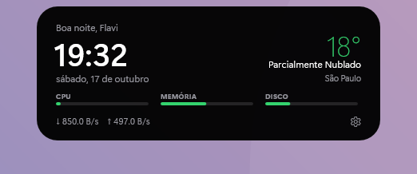
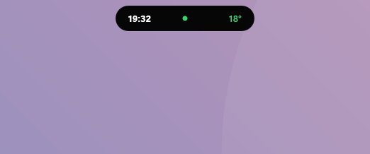
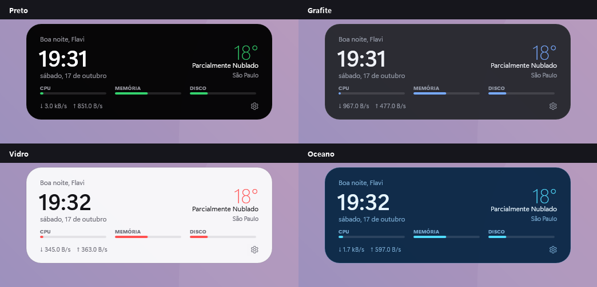
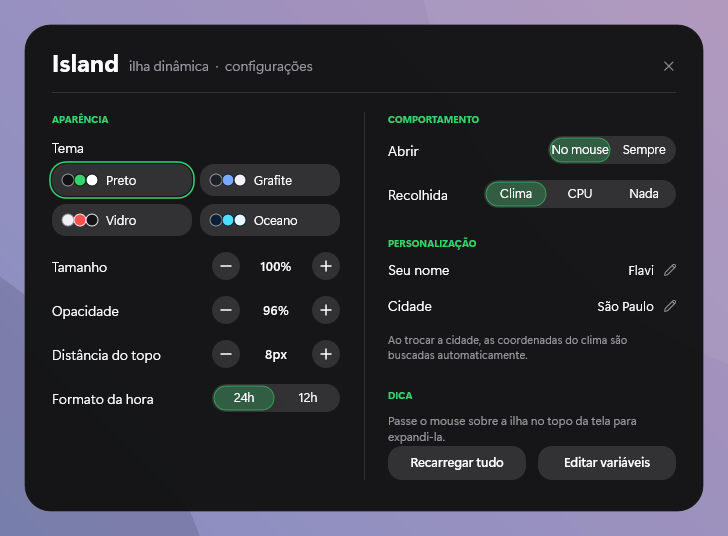

# Island

**Uma pílula no topo da tela que se expande com animação ao passar o mouse.**

*Island — A pill at the top of the screen that expands with an animation on hover.*

Agora também em inglês · Now also in English · [English below](#english)

Skin para o [Rainmeter](https://www.rainmeter.net), minimalista e com tela de configurações própria.

Recolhida:

[**⬇ Baixar Island.rmskin**](https://github.com/flavioferr/rainmeter-island/releases/latest/download/Island.rmskin)

## Sobre

O Island fica discreto no topo da tela mostrando só a hora e a temperatura. Ao passar o mouse, ele se expande com uma animação suave e mostra saudação, data, clima, barras de CPU/memória/disco e rede.

## Widgets

| Widget | O que mostra |
|---|---|
| **Ilha** | recolhida: hora e clima (ou CPU); expandida: tudo |

## Temas

## Configurações

Clique com o botão direito em qualquer widget → **Configurações**. Tudo é salvo na hora.

- 4 temas: Preto, Grafite, Vidro e Oceano
- Abrir ao passar o mouse ou ficar sempre aberta
- O que aparece recolhida: clima, CPU ou nada
- Distância do topo e opacidade
- Tamanho, 24h/12h, nome e cidade

## Instalação

1. Instale o [Rainmeter](https://www.rainmeter.net) (4.5 ou mais novo).
2. Baixe o [`Island.rmskin`](https://github.com/flavioferr/rainmeter-island/releases/latest) na página de Releases.
3. Dê dois cliques no arquivo e clique em **Install**.
4. Na primeira vez, os widgets aparecem já posicionados e as configurações abrem sozinhas.

Instalação manual: copie a pasta [`Island`](Island) para `Documentos\Rainmeter\Skins` e carregue pelo gerenciador do Rainmeter.

## Dicas

- **Idioma:** botão direito em qualquer widget → **English** (ou o botão **EN** nas configurações). Para voltar, **Português**.
- **Clima:** digite sua cidade nas configurações; as coordenadas são buscadas sozinhas (se não encontrar, tente sem acento). Os dados vêm do [Open-Meteo](https://open-meteo.com), gratuito e sem chave de API.
- **Mover:** arraste os widgets com o mouse.
- **Ajustes avançados:** o botão *Editar variáveis* abre o `@Resources/Variables.inc`.

## Requisitos

Windows 10 ou 11 e Rainmeter 4.5+. As fontes (Segoe UI Variable, Segoe Fluent Icons, Bahnschrift, Georgia, Consolas) já vêm com o Windows 11.

## Coleção

Outras skins da mesma coleção:

- [Lumen](https://github.com/flavioferr/rainmeter-lumen) — Cartões escuros e minimalistas: relógio, sistema, rede, clima e atalhos.
- [Horizon](https://github.com/flavioferr/rainmeter-horizon) — Uma barra de status fina e flutuante no topo (ou no rodapé) da tela.
- [Orbit](https://github.com/flavioferr/rainmeter-orbit) — Relógio analógico e medidores circulares com gradiente neon.
- [Shell](https://github.com/flavioferr/rainmeter-shell) — Uma janela de terminal no estilo neofetch com as informações do seu PC.
- [Folio](https://github.com/flavioferr/rainmeter-folio) — Tipografia editorial com serifa, sem caixas, como uma página de revista.
- [Bento](https://github.com/flavioferr/rainmeter-bento) — Uma grade de blocos coloridos com relógio, calendário, clima e sistema.
- [Prisma](https://github.com/flavioferr/rainmeter-prisma) — Uma barra lateral de vidro fosco na altura da tela.
- [Linea](https://github.com/flavioferr/rainmeter-linea) — Linhas de progresso do dia, da semana, do mês e do ano, mais a linha do sol.
- [Pixel](https://github.com/flavioferr/rainmeter-pixel) — Um relógio em matriz de pontos numa tela de LCD retrô.
- [Soft](https://github.com/flavioferr/rainmeter-soft) — Painéis em relevo (neumorfismo) com um termostato circular para o clima.
- [Swiss](https://github.com/flavioferr/rainmeter-swiss) — Um pôster tipográfico suíço com horas gigantes e a faixa da semana.

---

## English

**Island** — A pill at the top of the screen that expands with an animation on hover.

A minimalist skin for [Rainmeter](https://www.rainmeter.net) with its own settings screen, now in **English and Portuguese**.

### Widgets

| Widget | What it shows |
|---|---|
| **Island** | Pill at the top of the screen that expands on hover, with time, weather and system. |

### Themes

4 ready-made themes: Black, Graphite, Glass, Ocean.

### Installation

1. Install [Rainmeter](https://www.rainmeter.net) (4.5 or newer).
2. Download [`Island.rmskin`](https://github.com/flavioferr/rainmeter-island/releases/latest) from the Releases page.
3. Double-click the file and click **Install**.
4. Right-click any widget and choose **English**. The whole suite switches language (and back with **Português**).

### Tips

- **Settings:** right-click any widget → **Settings** (there is also an **EN/PT** button next to the close button).
- **Music:** the player reads everything in the Windows media controls — Spotify, YouTube, Netflix and any website in the browser, Apple Music, Deezer, VLC… The [WebNowPlaying](https://github.com/keifufu/WebNowPlaying-Rainmeter) plugin (MIT) is included in the `.rmskin`.
- **Weather:** type your city in the settings; the coordinates are looked up automatically. Data from [Open-Meteo](https://open-meteo.com), free and without an API key.

### Requirements

Windows 10 or 11 and Rainmeter 4.5+. If the player stays empty, install the [Microsoft Visual C++ Redistributable](https://aka.ms/vs/17/release/vc_redist.x64.exe).

### License

[CC BY-NC-SA 4.0](LICENSE.md) — use, modify and share with credit, non-commercially.

---

## Licença

[CC BY-NC-SA 4.0](LICENSE.md) — use, modifique e compartilhe, dando crédito e sem fins comerciais.
